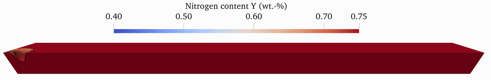

# OpenFOAM-LPBF-HighNitrogenSteel-Fe-Cr-C-N
## 🔬 Scientific Introduction

This specialized **OpenFOAM solver**, based on the interFoam framework, is modified to simulate the **Laser Powder Bed Fusion (LPBF)** process of **High Nitrogen Steels (HNS)**. It provides a fully coupled multi-physics approach to evaluate how laser-induced thermal dynamics drive **nitrogen transport and outgassing**.

<p align="center">
  
</p>

The solver integrates several critical physical phenomena to accurately capture the melt pool behavior:

**Laser-Material Interaction:** Utilizes a custom Discrete Ray Tracing Method (DTRM) to model the laser as a volumetric heat source with various intensity profiles, such as Gaussian or uniform distributions.

**Thermo-Fluid Dynamics:** Resolves the transient temperature field including latent heat of fusion (`L`) and vaporization (`Lv​`), while the momentum equations account for Marangoni convection (`dσ/dT`), surface tension, and recoil pressure.

**Species Transport & Nitrogen Kinetics:** A transport equation (`CEqn.H`) tracks the nitrogen mass fraction (`Y`). This model incorporates phase-dependent diffusion coefficients for both liquid and solid states.

**Interfacial Outgassing:** Nitrogen loss is explicitly modeled at the gas-metal interface using a sink term derived from the thermodynamic solubility limit (`Ysat`​) and kinetic mass transfer coefficients (`krate`​).

By coupling convective redistribution with localized interfacial kinetics, this tool enables the prediction of nitrogen depletion and the optimization of process parameters to ensure the mechanical integrity of additively manufactured HNS components.

## 🚀 Getting Started / Tutorial
### 1. Prerequisites

This solver and the accompanying case files have been specifically developed and tested for `OpenFOAM v2112`. Please ensure that this version is installed on your system.

Before proceeding, make sure your OpenFOAM environment variables are loaded in your terminal (e.g., by running `source /opt/OpenFOAM/OpenFOAM-v2112/etc/bashrc` or your specific alias).

### 2. Compiling the Solver (Installation)

The code consists of a custom radiation/ray-tracing model (`laserDTRM`) and the main multi-physics solver. They must be compiled in the correct order.

#### Step 2.1: Compile the Laser Model
First, navigate into the radiation model directory, clean up any old build files, and compile the library:
```Bash
$ cd <path_to_repository>/laserDTRM
$ wclean
$ wmake
```
#### Step 2.2: Compile the Main Solver
Next, move up to the main solver directory to compile the core executable:
```Bash
$ cd ..
$ wclean
$ wmake
```
Upon successful compilation, the executable (named `X30Cr15N_Sh`) will be generated and placed in your OpenFOAM user application binary directory (`$FOAM_USER_APPBIN`).

### 3. Running the Simulation Case

The provided case directory includes a pre-configured Allrun script that automates the entire simulation workflow. This script sequentially executes the following steps:

`blockMesh`: Generates the computational mesh.

`setFields`: Initializes the starting fields (like the phase fractions and nitrogen concentration).

`decomposePar`: Decomposes the mesh into subdomains for parallel processing.

`mpirun -np 192 X30Cr15N_Sh -parallel`: Executes the main simulation solver in parallel.

`reconstructPar`: Reconstructs the distributed data back into a single domain for post-processing.

To start the simulation:
Navigate to your case folder, ensure the script is executable, and run it:
```Bash
$ cd <path_to_case>
$ chmod +x Allrun
$ ./Allrun
```

#### 3.1 Parallelization (MPI) Setup

The current case setup is highly optimized for High-Performance Computing (HPC) clusters. In the system/decomposeParDict file, the numberOfSubdomains is configured to 192 CPU cores. The Allrun script is also set to execute the solver using mpirun -np 192.

If you are running this case on a standard desktop PC or a laptop, you must adjust these values to match your available hardware to prevent system crashes:

Open `system/decomposeParDict` and change `numberOfSubdomains 192;` to the number of physical cores you want to use (e.g., 8 or 16).

Open the Allrun script and modify the execution line to match your chosen core count  (e.g., change `mpirun -np 192` to mpirun `-np 8`).

## Cite this work

If you use this solver in your research, we also kindly ask you to cite the corresponding publication which describes the underlying physical models and validation cases in detail or the repository for the solver:

L. Buchholz, S. Garthe, L. Becker, L. Mädler, S. Weber, N. Ellendt, Numerical modeling of nitrogen transport and loss during laser powder bed fusion of high nitrogen steels, International Journal of Heat and Mass Transfer 271 (2026) 129271. doi:https://doi.org/10.1016/j.ijheatmasstransfer.2026.129271

Buchholz, L., Garthe, S., Becker, L., Mädler, L., Weber, S., & Ellendt, N. (2026). Numerical modeling of nitrogen transport and loss during laser powder bed fusion of high nitrogen steels [Computer software]. Zenodo. https://doi.org/10.5281/zenodo.21410733

Citing this research helps us to maintain and further develop the solver. Thank you for supporting our research!
